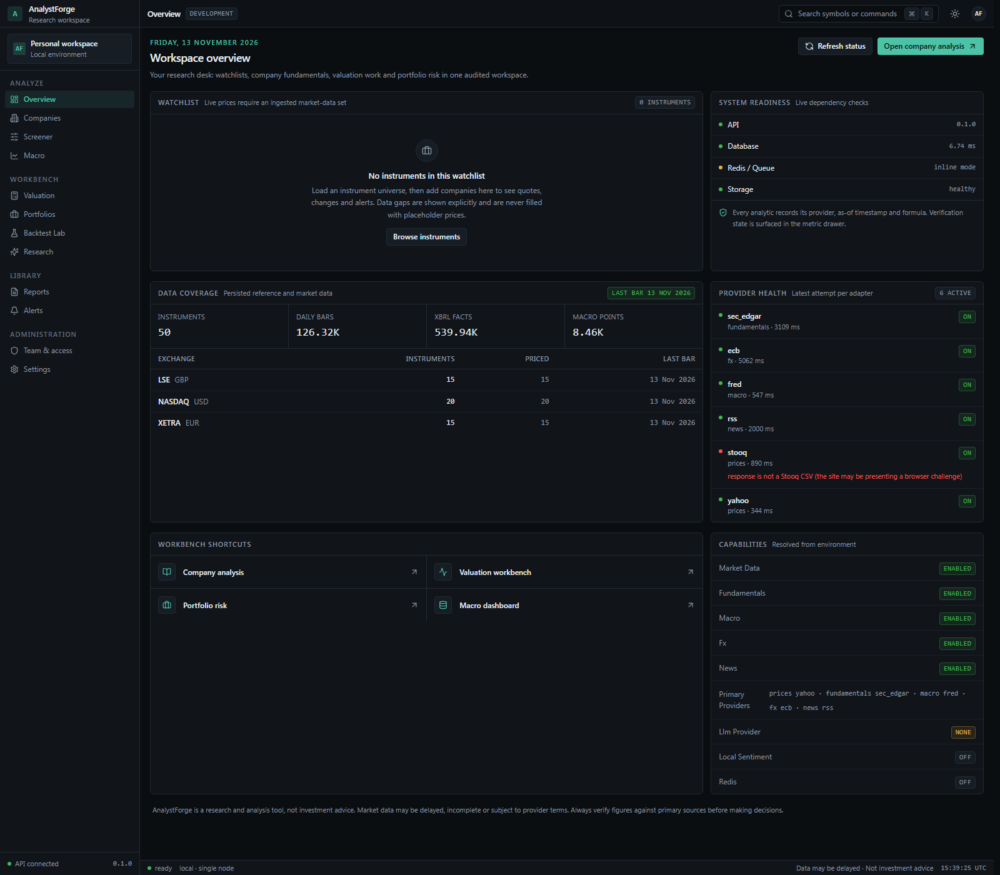

# AnalystForge

A professional research, valuation, portfolio-risk and macro analysis platform for finance
analysts. AnalystForge replaces a mix of spreadsheets and terminal snapshots with one audited
workspace: sourced data, tested formulas, versioned models and AI research that cites its evidence.

> **Not investment advice.** Market data may be delayed or incomplete. Verify every figure against
> primary sources before acting. See [docs/DATA_LICENSING.md](docs/DATA_LICENSING.md).

## What it does

- **Market & fundamentals** — instrument master, adjusted OHLCV, SEC XBRL statements, 50+ ratios
- **Valuation** — DCF (FCFF/FCFE), WACC, comps, scenarios, Monte Carlo and Excel exports
- **Portfolio & risk** — transactions, TWR/XIRR, attribution, VaR/CVaR, stress tests, optimisation
- **Backtesting** — point-in-time engine, realistic costs, walk-forward and overfitting diagnostics
- **Screener & macro** — saved screens, alerts, FRED-based macro dashboards
- **Research assistant** — grounded answers over filings and news with passage-level citations
- **Reporting & API** — PDF/Excel/PowerPoint exports, public REST API, Python SDK (`analystforge-py`)

Every metric is traceable to its provider, as-of time and formula. There is no random or
placeholder data in analysis paths; missing data is shown as unavailable with the reason.



## Quick start (Docker)

Prerequisites: Docker Engine 24+ with Compose v2.

```bash
git clone https://github.com/anmoliot/AnalystForge.git analystforge
cd analystforge
python scripts/gen_env.py
docker compose up -d --build
```

The environment generator writes random development secrets on first run. Compose builds the images and starts
PostgreSQL 16 + TimescaleDB, Redis, the API, the worker, the web app and Nginx.

| Service | URL |
|---|---|
| App | http://localhost:8080 |
| API docs | http://localhost:8080/docs |
| Mail catcher (dev) | http://localhost:8025 |

Then load real data:

```bash
make ingest
```

## Data providers and ingestion

The default stack needs no paid keys. Prices come from Yahoo's chart API, fundamentals from SEC
EDGAR XBRL companyfacts, macro series from FRED CSV, FX from ECB reference rates and news from
public RSS feeds. Stooq is configured as a secondary price adapter; provider failover is recorded
in `provider_health` and shown on the workspace overview.

```bash
make seed                    # exchanges, instruments and provider symbols
make ingest-local            # prices, fundamentals, macro, FX and news against DATABASE_URL
make quality                 # structural checks; exits non-zero on errors
```

The same commands run inside the stack with `make ingest`. Provider order and keys live in `.env`
(`PRICE_PROVIDERS`, `NEWS_RSS_FEEDS`, `SEC_USER_AGENT`, optional paid keys). Adapters that require
keys are tested against recorded fixtures and stay disabled until a key is present.

Inspect what was actually persisted:

- `GET /api/v1/data/coverage` — instruments, bars, facts, macro points, FX and news by exchange
- `GET /api/v1/providers/health` — latest attempt per adapter, including errors and cooldowns
- `GET /api/v1/data/quality` — missing/stale coverage and vendor anomalies with severity

Missing values stay missing. The platform never fills gaps with zeroes or placeholder prices.
Warnings (for example, vendor OHLC bound violations) retain the raw data and are surfaced with their
instrument and date.

## Local development (without Docker)

Prerequisites: Python 3.12, Node 22, [uv](https://docs.astral.sh/uv/), PostgreSQL 16+
(TimescaleDB optional locally), Redis optional.

~~~bash
python scripts/gen_env.py
uv sync --all-packages
cd apps/web
npm ci
cd ../..
# Set DATABASE_URL in .env to an existing PostgreSQL database.
uv run alembic -c apps/api/alembic.ini upgrade head
uv run uvicorn analystforge.api.main:app --host 127.0.0.1 --port 8000
# In another terminal
cd apps/web
npm run dev
~~~

Version 0.1.0 is defined in the root pyproject.toml. Package/web mirrors are checked by
scripts/check_version.py. See docs/KNOWN_LIMITATIONS.md before deployment. The migration chain
does not yet create every later model table on a fresh PostgreSQL database.

## Recorded reviewer walkthrough

This walkthrough creates an ephemeral SQLite database, loads recorded historical AAPL bars and
SEC facts, and starts the ordinary API and Vite servers. Login, company statements, user-assumption
DCF, portfolio/risk, backtest, screener, research and PDF download are verified.
Screenshots are historical test evidence. Run from apps/web after installing workspace dependencies.

~~~bash
npx playwright install chromium
npm run test:e2e
~~~

The test API runs on 127.0.0.1:8765 and Vite on 127.0.0.1:4174 during the run.
TEST_DATABASE_URL can select a disposable PostgreSQL database whose name ends in _test.
Redis is optional. Live ingestion uses uv run analystforge-data seed followed by
uv run analystforge-data ingest-all against your configured database. DEMO_MODE remains false.
See tests/e2e/fixtures/README.md for provenance.

## Tests and quality gates

```bash
make test                    # Python + web unit tests
make lint                    # ruff, mypy (quant), eslint, tsc
make coverage                # coverage report; packages/quant is gated at 95%
make e2e                     # Playwright starts isolated API and Vite
```

## Repository layout

```
apps/api              FastAPI app (routers → services → repositories → providers)
apps/web              React 19 + TypeScript frontend
apps/worker           Arq background jobs and schedules
packages/quant        Pure finance library (no I/O); fully unit-tested
packages/providers    Swappable data-provider adapters
packages/sdk-python   AnalystForge Python SDK
infra                 Docker, Nginx, deployment
docs                  Architecture, ADRs, formulas, runbooks
tests                 End-to-end, load and contract tests
```

## Documentation

- [API reference](docs/API.md)
- [User guide](docs/USER_GUIDE.md)
- [Runbook](docs/RUNBOOK.md)
- [Security](SECURITY.md)
- [Contributing](CONTRIBUTING.md)
- [Changelog](CHANGELOG.md)
- [Architecture](docs/ARCHITECTURE.md)
- [Decisions (ADRs)](docs/DECISIONS.md)
- [Known limitations](docs/KNOWN_LIMITATIONS.md)
- [Progress](docs/PROGRESS.md)
- [Data licensing](docs/DATA_LICENSING.md)

## Security

Secrets live only in `.env` (git-ignored) and are generated with `secrets.token_hex`. Production
startup refuses weak configuration: non-Postgres databases, missing Redis, insecure cookies,
wildcard CORS, debug mode or demo mode. Report vulnerabilities privately to the maintainers.

## License

MIT — see [LICENSE](LICENSE). Data provider terms apply separately.
