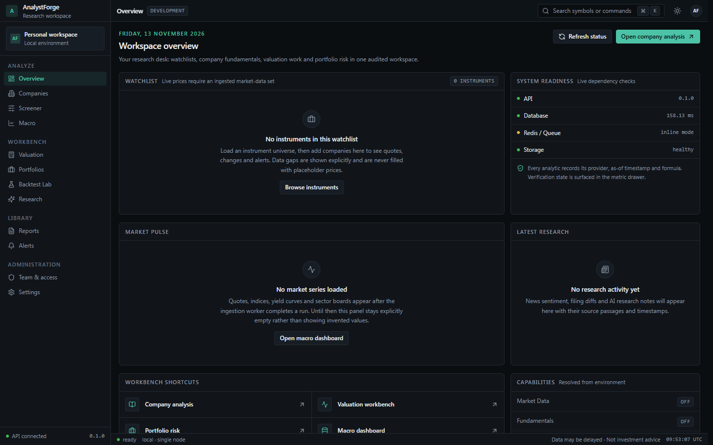

# AnalystForge

A professional research, valuation, portfolio-risk and macro analysis platform for finance
analysts. AnalystForge replaces a mix of spreadsheets and terminal snapshots with one audited
workspace: sourced data, tested formulas, versioned models and AI research that cites its evidence.

> **Not investment advice.** Market data may be delayed or incomplete. Verify every figure against
> primary sources before acting. See [docs/DATA_LICENSING.md](docs/DATA_LICENSING.md).

## What it does

- **Market & fundamentals** — instrument master, adjusted OHLCV, SEC XBRL statements, 50+ ratios
- **Valuation** — DCF (FCFF/FCFE), WACC, comps, scenarios, Monte Carlo and Excel exports
- **Portfolio & risk** — transactions, TWR/XIRR, attribution, VaR/CVaR, stress tests, optimisation
- **Backtesting** — point-in-time engine, realistic costs, walk-forward and overfitting diagnostics
- **Screener & macro** — saved screens, alerts, FRED-based macro dashboards
- **Research assistant** — grounded answers over filings and news with passage-level citations
- **Reporting & API** — PDF/Excel/PowerPoint exports, public REST API, Python SDK (`analystforge-py`)

Every metric is traceable to its provider, as-of time and formula. There is no random or
placeholder data in analysis paths; missing data is shown as unavailable with the reason.



## Quick start (Docker)

Prerequisites: Docker Engine 24+ with Compose v2.

```bash
git clone <your-repo-url> analystforge
cd analystforge
make up
```

`make up` generates a `.env` with random secrets on first run, builds the images and starts
PostgreSQL 16 + TimescaleDB, Redis, the API, the worker, the web app and Nginx.

| Service | URL |
|---|---|
| App | http://localhost:8080 |
| API docs | http://localhost:8080/docs |
| Mail catcher (dev) | http://localhost:8025 |

Then load real data:

```bash
make ingest
```

## Local development (without Docker)

Prerequisites: Python 3.12, Node 22, [uv](https://docs.astral.sh/uv/), PostgreSQL 16+
(TimescaleDB optional locally), Redis optional.

```bash
make env                     # generate .env with random secrets
make bootstrap               # uv sync + npm install
createdb analystforge        # or use the connection string in .env
make migrate                 # apply Alembic migrations
make dev-api                 # API on :8000
make dev-web                 # Vite on :5173 (proxies /api to :8000)
```

## Tests and quality gates

```bash
make test                    # Python + web unit tests
make lint                    # ruff, mypy (quant), eslint, tsc
make coverage                # coverage report; packages/quant is gated at 95%
make e2e                     # Playwright against a running stack
```

## Repository layout

```
apps/api              FastAPI app (routers → services → repositories → providers)
apps/web              React 19 + TypeScript frontend
apps/worker           Arq background jobs and schedules
packages/quant        Pure finance library (no I/O); fully unit-tested
packages/providers    Swappable data-provider adapters
packages/sdk-python   AnalystForge Python SDK
infra                 Docker, Nginx, deployment
docs                  Architecture, ADRs, formulas, runbooks
tests                 End-to-end, load and contract tests
```

## Documentation

- [Architecture](docs/ARCHITECTURE.md)
- [Decisions (ADRs)](docs/DECISIONS.md)
- [Known limitations](docs/KNOWN_LIMITATIONS.md)
- [Progress](docs/PROGRESS.md)
- [Data licensing](docs/DATA_LICENSING.md)

## Security

Secrets live only in `.env` (git-ignored) and are generated with `secrets.token_hex`. Production
startup refuses weak configuration: non-Postgres databases, missing Redis, insecure cookies,
wildcard CORS, debug mode or demo mode. Report vulnerabilities privately to the maintainers.

## License

MIT — see [LICENSE](LICENSE). Data provider terms apply separately.
