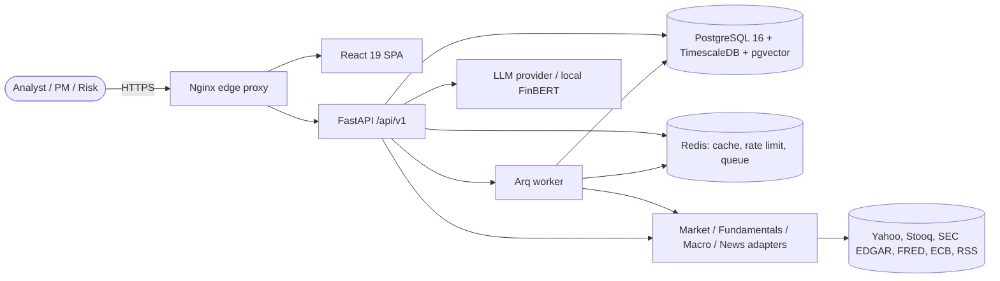

# Architecture

## System context



## Layering

The dependency rule is one-directional:

```
routers  ->  services  ->  repositories  ->  providers (ports/adapters)
                    \-> packages.quant (pure)
```

- **routers** parse and validate HTTP input, enforce auth dependencies and return schemas.
- **services** own business rules, transactions and audit events. No SQL and no HTTP.
- **repositories** own SQLAlchemy queries and always scope tenant-owned rows by `tenant_id`.
- **providers** are pure adapters behind typed ports; they know nothing about the database.
- **packages/quant** has zero web/database imports and uses `Decimal` for money.

The architecture is enforced by an import-linter-style test (`tests/test_layering.py`) and by
mypy strict on the quant package.

## Monorepo

| Path | Purpose |
|---|---|
| `apps/api` | FastAPI app, routers, services, repositories, auth, reporting |
| `apps/worker` | Arq jobs: ingestion, screens, alerts, scheduled reports |
| `apps/web` | Vite + React 19 + TypeScript SPA |
| `packages/quant` | Pure finance math: returns, ratios, DCF, risk, optimisation, backtest metrics |
| `packages/providers` | Provider interfaces and adapters with retry/fallback/caching hooks |
| `packages/sdk-python` | Typed HTTP client published locally as `analystforge-py` |
| `infra` | Dockerfiles, Nginx configs, optional Kubernetes manifests |
| `tests` | Contract, load and end-to-end checks |

Packaging uses a **uv workspace**, with every Python package under the shared `analystforge`
namespace. This allows strict dependency direction while keeping one lockfile and one virtualenv
for local development.

## Data model and tenancy

- Global reference data: `instruments`, `price_bars`, `macro_series`, `macro_observations`,
  `news_articles`, `filings` and `financial_facts`. These are shared across tenants so the same
  provider payload is stored once. This is a deliberate exception to the tenant-column rule (see
  ADR-004); licensing and provenance are attached to the stored payload.
- Tenant-owned data: users, portfolios, transactions, watchlists, screens, alerts, valuation
  models, notes, uploads, reports, API keys, audit entries. Every table carries `tenant_id` and
  every repository query includes it.
- Row-level filtering is centralized in `TenantRepository`; IDOR tests assert that a resource ID
  from another tenant returns 404 rather than leaking existence.
- TimescaleDB hypertables partition `price_bars` and `macro_observations` by time. Continuous
  aggregates serve daily/weekly bars; provenance columns (`source`, `fetched_at`, `quality`) travel
  with every row.

## Data flows

### Market data ingestion

1. The seed service upserts the curated exchange, instrument and provider-symbol universe.
2. The ingestion service resolves the instrument universe and asks a `MarketDataProvider` for the
   date range. Incremental runs start at the latest stored bar minus seven days; full runs refetch
   the configured window.
3. The adapter fetches through the shared HTTPS client with caching, retries/backoff and rate
   limiting, normalises to a common bar schema and returns provenance (`provider`, retrieved time,
   adjustments). Vendor pence quotes are converted to pounds on write.
4. A data-quality pass detects missing references, stale or absent coverage, non-positive prices,
   extreme returns and vendor OHLC bound violations, and records findings with a severity. Missing
   values are never zero-filled or replaced with synthetic data.
5. Rows are upserted on natural keys into `price_bars` (and the corresponding reference tables);
   every provider attempt, including failures, is persisted in `provider_health`.
6. The provider router fails over to the next configured adapter and records which provider actually
   served the data. Cooldowns move failing adapters behind healthy alternatives.

### Fundamentals

SEC EDGAR company facts (XBRL) are fetched with the required descriptive `User-Agent`, cached for
24 hours, and stored raw for audit. A mapping layer maps taxonomy tags to a standard chart of
accounts with restatement detection. Derived statements are computed in `packages/quant` from
stored facts, so every ratio can cite the fact IDs it used.

### Analytics and valuation

Request → service → load point-in-time inputs from repositories → pure quant functions → response
with `sources`, `as_of`, `formula` metadata. Valuation model versions store the complete assumption
snapshot and outputs; edits append a new version (no destructive updates).

### AI research

Ingestion extracts full article/filing text (trafilatura / pypdf), chunks it, computes embeddings
(sentence-transformers or a documented lexical fallback), and stores chunks with pgvector. The
assistant retrieves top passages, refuses when evidence is below threshold, and returns citations
with document IDs, passage offsets and retrieval scores. All model calls and tool executions are
audited.

## Caching and performance

- Redis keys are namespaced by data type: `md:bars:{instrument}:{interval}:{range}`,
  `fund:{instrument}:{period}`, `macro:{series}`, `screen:{hash}`.
- TTLs: intraday quotes 15 s, daily bars 15 min, fundamentals 24 h, macro 12 h, filings immutable
  (ETag-based), computed screens 5 min.
- ETags on heavy read endpoints; `If-None-Match` returns 304.
- Query budgets: list endpoints paginate and eager-load relationships; repository tests assert
  query counts for the company page and portfolio holdings.
- Heavy analytics are cached by a hash of their normalized inputs and as-of date.

## Background jobs

Arq (asyncio-native, Redis-backed) handles ingestion, scheduled screens, alerts, report rendering
and embedding. In single-node development without Redis, the API runs jobs inline through the same
service functions; production refuses to start without Redis. Every job run is recorded in
`job_runs` with status, timings, payload hash and error, and exposes a status endpoint for the UI.

## Authentication and authorization

- Argon2id password hashing; password policy and breached-password screening hook.
- Access JWT (15 min) in memory/response, refresh token (30 days) rotated on every use, stored as a
  hashed value in `refresh_tokens` with family-revocation on reuse detection.
- Tokens delivered as `httpOnly`, `SameSite=Lax` (Secure in production) cookies.
- TOTP 2FA with encrypted secrets, one-time recovery codes.
- RBAC roles: `ADMIN`, `PORTFOLIO_MANAGER`, `ANALYST`, `READ_ONLY`, enforced in a central
  permission matrix and tested route by route.
- API keys: prefix + Argon2 hash, scoped permissions, per-key rate limit and usage tracking.
- Audit log is append-only (PostgreSQL trigger blocks UPDATE/DELETE).

## Observability

- structlog JSON logs with request/tenant/user context, request IDs accepted from a validated
  header or generated.
- Prometheus metrics: HTTP counts/latency, provider calls/latency/outcomes, job outcomes, alerts.
- OpenTelemetry traces for HTTP and SQL (optional OTLP endpoint).
- Sentry integration when `SENTRY_DSN` is set, with PII disabled.
- `/health` (liveness), `/ready` (database, Redis, storage), `/metrics` (restricted by Nginx).

## Failure and degraded modes

| Missing dependency | Behaviour |
|---|---|
| Provider API key | Adapter is disabled and reported in provider health; UI shows reason |
| Redis | Development: inline jobs + in-process cache. Production: refuse to start |
| LLM key | Research assistant returns a configuration error, never a fabricated answer |
| FinBERT | Sentiment service falls back to disclosed LLM sentiment or "unavailable" |
| News full text | Article is stored as headline-only and **not** used for sentiment |
| TimescaleDB | Plain PostgreSQL tables still work; hypertable migration is skipped with a warning |

No failure path silently substitutes demo or random data. Demo mode is explicit, banner-labelled
and disabled in production by configuration validation.
